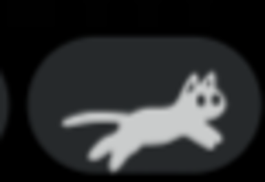

# cpurr 🐈

A cat that runs in your [Noctalia](https://noctalia.dev) bar based on **CPU
usage** — the busier your machine, the faster it runs. After a few quiet cycles
it curls up and sleeps.



Pose art and animation timing are ported from
[CarloCattano/waycat](https://github.com/CarloCattano/waycat) by Carlo Cattano
(a Waybar custom module); this plugin is a native Noctalia bar widget driven by
`noctalia.systemStats()` — no subprocesses.

## Install

```sh
git clone https://github.com/Deoxizn/cpurr.git
cd cpurr
./install.sh
noctalia msg plugins enable deoxizn/cpurr
```

Then add the `cpurr` widget to a bar — right-click the bar and open the widget
picker, or place it from Settings → Bar.

The installer copies the plugin to `~/.local/share/noctalia/plugins/cpurr/`
and downloads the pose font from the waycat repository.

Uninstall: `./install.sh --uninstall`, then remove the widget from the bar.

## Settings

| Key    | Type | Default | Description |
| ------ | ---- | ------- | ----------- |
| `size` | int  | `32`    | Pose art size in px. The bar clips widgets to its thickness, so keep it under that. |

Widget settings are reachable by middle-clicking the widget on the bar.

## How it works

- The cat reads `noctalia.systemStats().cpu.usagePercent` every tick.
- Frame delay: `clamp(1000 / (4 + cpu%), 30, 250)` ms — a sprint under load, a
  stroll at idle (same numbers as waycat's `catloop.sh`).
- Below 2% usage for 4 frames in a row, it switches to the sleeping poses.
- Drawn with a declarative `ui.label` using the Waycat font, which is what
  makes the `size` setting possible.

## Credits

- **Original project: [Waycat](https://github.com/CarloCattano/waycat) by Carlo
  Cattano.** cpurr is an independent Noctalia port of it: the cat pose art
  (the Waycat font) and the animation behavior from `catloop.sh` — frame
  timing, speed curve, sleep logic — both come from there. Not affiliated with
  the original project.
- The Waycat font is downloaded from the original repository at install time
  and is not redistributed in this repository.
- API patterns borrowed from Noctalia's official bongocat plugin.

## License

MIT — see [LICENSE](LICENSE). The Waycat font remains the property of its
author, Carlo Cattano.
